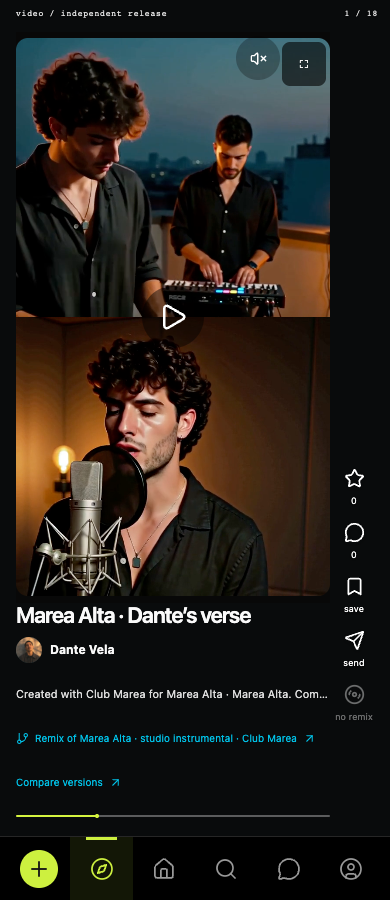
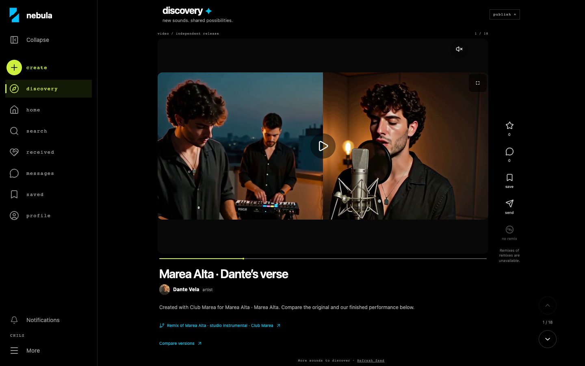
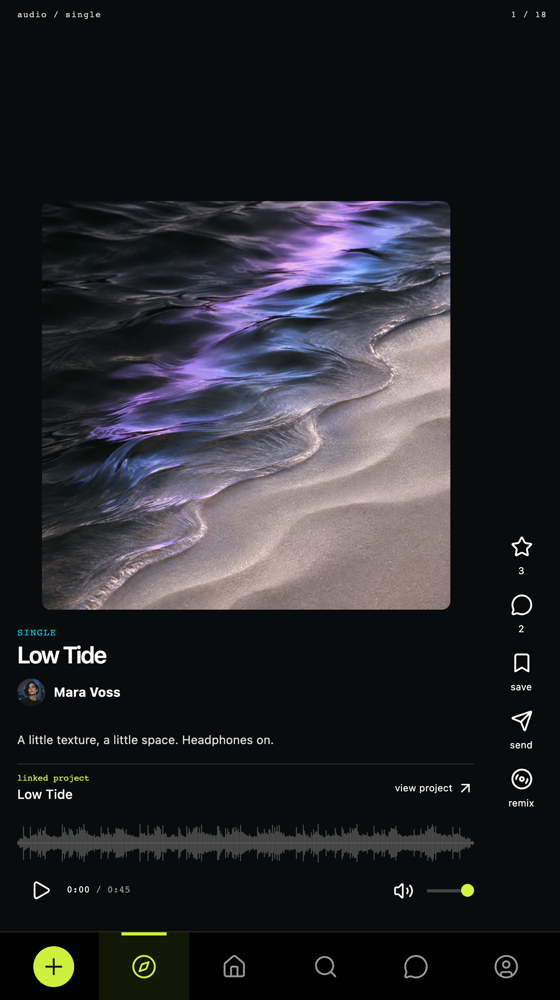
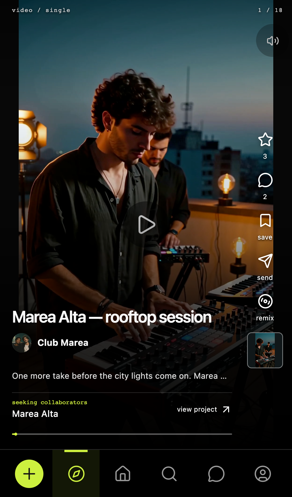

# Remix adaptable y Discovery — verificación del 9 de noviembre de 2026

## Resultado

Activado en `http://127.0.0.1:4186`, sin resetear la presentación. Solo `nebula-demo`.

- Remix compatible de dos videos: original arriba/aportación abajo en móvil; original izquierda/aportación derecha desde 768 px. Una fuente de imagen/sonido, sin segundo reloj multimedia.
- Exportación vertical 720 × 1280; regiones iguales de 720 × 640 y recorte proporcional. Ajuste independiente, teclado y reset conservados. Borradores legacy requieren reconstrucción explícita.
- Marea regenerado desde originales, con encuadre de rostro revisado. Audio decodificado idéntico al anterior (SHA-256 `5b94858139ee43810a29e2dc21d64961d821434e14552b335d880ae6ab721d77`); duración 7.833333 s. Afterglow y LUNA sin cambios.
- Discovery video: tap/teclado para pausa, progreso discreto y mute/unmute compacto, sin fila permanente de reproducción/volumen. Discovery audio móvil: portada mayor y controles junto a la navegación, eliminando el vacío inferior.

## Verificación ejecutada

| Ejecución | Resultado |
| --- | --- |
| `pnpm test` | 81/81 |
| `node --test server/*.test.mjs` | 89/89 |
| Fixture, catálogo e importación LUNA | 6/6 |
| Presentación: adaptive-remix, audiovisual, video, catalog, shared-artist, collaboration-preparation | 34/34, Chrome escritorio y móvil emulado |
| Remix integrado (`tests-remix/remix.spec.ts`) | 14/14, audio/video, exportación, borrador, permisos y envío privado con adjuntos |
| Navegación y retorno (`tests-shared`) | 18/18, Artist/Investor, Create, Messages, perfiles, búsqueda y publicación activa |
| Pantalla completa y orientación horizontal | 2/2 adicionales, reloj conservado y regreso a navegación |
| TypeScript y build de producción | Aprobados; avisos existentes de sourcemaps/tamaño del bundle |

Las pruebas comprueban 390, 521, 767, 768, 1024 y 1440 px según el componente; geometría del canvas comparada píxel a píxel con las dos regiones de la fuente, reloj/volumen conservados al redimensionar, fallback ante fallo de canvas y revisión del ejemplo desde ambos artistas. Las pruebas de exportación usan videos cuadrados y horizontales además de los ejemplos verticales. Dispositivos de grabación y móvil son emulados; no equivale a probar Safari/iOS o hardware físico. No se ha realizado una nueva auditoría general de la plataforma.

## Datos y activación

Respaldo previo: `.data/backups/before-adaptive-remix-20261109-175303`. Respaldo inmediatamente anterior a activación: `.data/backups/adaptive-remix-preactivation`.

Comparación SQLite antes/después, tanto ensayo como escena inicial: cambió solo la publicación Marea 14, se añadió un archivo multimedia registrado y se actualizaron las referencias/metadatos de sus dos propuestas de ejemplo. Los términos, textos y permisos no cambiaron. Todas las demás tablas permanecieron idénticas, incluidas cuentas, estado de proyectos, relaciones y sesiones. Los 57 archivos previos conservaron exactamente su SHA-256. No se sobrescribió ni borró el resultado antiguo. Evidencia local: `.data/adaptive-data-preservation.json` y `.data/adaptive-media-verification.json`.

La revisión en Chrome del servidor activado confirmó que Create, Messages y los demás accesos permanecen disponibles. No se tocó el formulario abierto en la otra pestaña del usuario.

## Archivos de esta corrección

- Reproductor: `artifacts/nebula/src/features/remix/adaptive-video.tsx`, `adaptive-video.css`, `video-framing.tsx`, `audio-comparison.tsx`, `studio.tsx`.
- Integración: `features/discovery/{media-player.tsx,discovery.css,demo-posts.ts,live-discovery.tsx,project-community.tsx,version-comparison.tsx}` y `features/collaborations/{index.tsx,proposal-preparation.tsx}` dentro de `artifacts/nebula/src`.
- Metadatos de propuesta: `lib/local/src/collaborations.ts`, `server/remix-drafts.ts`, `server/collaborations.ts`.
- Fixture: `scripts/presentation-split-remix.py`, `presentation/seed/{manifest.json,scene.sqlite}`, `presentation/assets/video/marea-vocal-split-v1.mp4`.
- Verificación: `tests-presentation/adaptive-remix.spec.ts`, este reporte y la sección 11 del handoff.

## Evidencia visual

Archivo exportado: [Marea vertical corregido](../presentation/assets/video/marea-vocal-split-v1.mp4).
