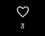
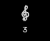
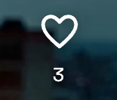
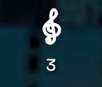
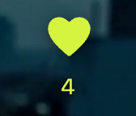

# Animación musical del like

Discovery transforma el corazón en clave de sol al dar like a un post, y vuelve al corazón relleno tras la confirmación del servidor. La secuencia normal dura unos 650 ms: 230 ms de transformación, pausa hasta los 420 ms y 230 ms de regreso. Una respuesta lenta mantiene la clave quieta; un fallo devuelve el estado anterior. Quitar el like no repite la animación.

El SVG interpola ocho curvas compatibles con Framer Motion. Conserva el espacio de 21 × 21 px, el contador y el color activo. Con movimiento reducido usa opacidad y formas fijas. La petición se envía al pulsar; su confirmación visual no espera a que termine la recarga del feed.

La protección de solicitudes existente y un bloqueo local evitan duplicados. Al cambiar de pieza o salir se cancelan los temporizadores y las respuestas tardías no reactivan la animación. Sin sesión se abre el diálogo de acceso habitual. No se modificaron endpoints, almacenamiento ni likes de comentarios.

## Capturas

| Corazón inicial | Clave durante la espera | Corazón confirmado |
| --- | --- | --- |
|  |  |  |

[Discovery en escritorio](screenshots/desktop-treble-clef-discovery.png) y [Discovery en móvil](screenshots/mobile-treble-clef-discovery.png).

| Móvil: inicial | Móvil: clave de sol | Móvil: confirmado |
| --- | --- | --- |
|  |  |  |

## Validación

Resultado final: **22 pruebas aprobadas y 2 omisiones intencionales** en Chrome escritorio y emulación iPhone 13. Son 12 casos nuevos del like y 10 regresiones originales; swipe solo se ejecuta en móvil y trackpad solo en escritorio. [Log completo](evidence/browser.txt).

`pnpm build` completó tipos, cliente y servidor. Permanecen las advertencias de sourcemaps y tamaño de bundle que ya constaban en la entrega anterior. [Log del build](evidence/build.txt).

La pasada inicial detectó que la animación esperaba también la recarga de datos, alargándola a unos cuatro segundos. Se corrigió para atender la confirmación del PUT por separado; las pruebas verifican la duración de la secuencia y la actualización real del contador.

Comando de navegador:

```sh
pnpm exec playwright test --config playwright.presentation.config.ts tests-presentation/discovery-like.spec.ts tests-presentation/discovery-tap.spec.ts tests-presentation/discovery-scroll-regression.spec.ts --reporter=line
```

Las pruebas utilizan la copia temporal de datos de `test-presentation-server.mjs`. No se reinician los datos de ensayo. Los casos cubren audio/video, respuesta rápida/lenta/fallida, reintento, pulsaciones repetidas, quitar like, teclado, navegación, invitados y movimiento reducido, además de las regresiones originales de pausa, controles, comentarios y scroll.

## Conservación y localhost

La [verificación](evidence/verification.json) confirma hashes idénticos para las dos portadas, el reproductor de Discovery, su scroll y los comentarios de escritorio. También conserva los datos completos y propietarios de los posts de Luna 17 y 18.

Escritorio (`127.0.0.1:4187`) y móvil (`localhost:4188`) responden HTTP 200 y sirven el mismo bundle con la animación. Los servidores existentes sirven los archivos estáticos recompilados; no fue necesario reiniciarlos ni tocar la base. Una pestaña abierta antes del cambio debe recargarse para usar el nuevo JavaScript.
